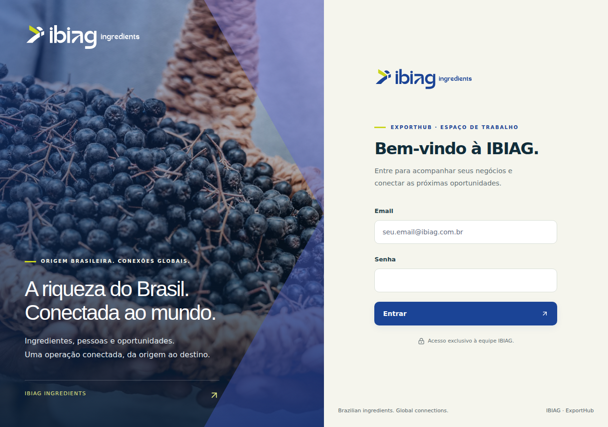

# Validação visual IBIAG — 19/10/2026

PR47: identidade visual aplicada ao candidato em desenvolvimento, sem integração à main nem publicação. Base:PR46 (embarques), por sua vez dependente de PR45/44 e do candidato de segurança PR28.

Código revisado:37affcf752ae8c5c80456ae6839edbdaca662b9c. Árvore:e5c9885567b58ca07c6f472b4c7cb4073146bdbb. As árvores local/remota foram comparadas e são idênticas.

## Referência e aplicação

Apresentação fornecida pelo usuário:Ibiag Ingredients Presentation EN.pdf,15 páginas. SHA256:1edd6e5e78472102d22e677029e95bbb615e98988355b0dc8534f41ecb2827af. Extraídos20 caminhos vetoriais da marca na página3 e o JPEG de açaí da página2. Variante branca mantém o detalhe verde-lima; o ícone usa as quatro formas originais do símbolo. Os SVGs contêm somente caminhos, sem scripts ou recursos externos. O PDF completo, contatos e fontes proprietárias não foram publicados no repositório.

Azul#1B4496, verde-lima#CAD51E, fundo marfim/oliva e texto azul-petróleo. Fotografias e diagonais aparecem na entrada/login; as áreas de trabalho usam superfícies mais discretas. Mantida a família Inter já usada, com alternativas locais; não foram extraídas ou redistribuídas Calibri/Serotiva.

Aplicação em login, entrada dos módulos, barra lateral/cabeçalho, cabeçalhos/abas compartilhados, cartões da Gestão, título/descrição/idioma e ícone do navegador. No celular, os painéis empilham; rótulos do formulário são associados e o menu tem nomes acessíveis. As mudanças não adicionam permissões, API, serviço de imagem, tracking, dados reais ou cobrança.

## Correções encontradas durante a validação

1. Pipeline39339785856: testes de interface e compilação passaram, mas o Chromium detectou falha ao decodificar o logo. O servidor sintético só servia /static e devolvia o HTML da SPA para /brand. Corrigido o servidor de teste para servir o diretório de marca, que o Nginx real já publica pelo diretório build.
2. Pipeline39340280000: testes e navegação passaram e produziram seis capturas. A inspeção visual encontrou o container de notificações ocupando uma célula do grid, deslocando o formulário de login para outra linha no desktop. O container foi movido para fora do grid e o navegador passou a verificar alinhamento/lado a lado e encaixe vertical no viewport.
3. Reforçados contraste/tamanho do rodapé, leitura dos textos secundários, destaque verde-lima e comportamento de movimento reduzido dos cartões.

Pipeline final39340923700 concluída com sucesso no SHA37affcf752ae8c5c80456ae6839edbdaca662b9c:396 testes de backend+56 subtestes (MongoDB real descartável e regressão Docker),287 testes de interface em16 suítes, compilação e fluxo Chromium completos. Jobs118361982279/118361982624. Sem skips no resumo de backend. O Chromium realizou login pelo formulário real, confirmou decodificação dos assets, alinhamento dos painéis desktop/encaixe no viewport, ausência de overflow horizontal em390px e funcionamento do menu móvel, além do fluxo existente de CRM/cálculo/pedido/embarque/documentos.

Artefato12228966766, produzido pela mesma execução/SHA. As capturas foram baixadas, verificadas e mantidas neste relatório para não depender da expiração do artefato de um dia. Testes locais da interface:287 aprovados; compilação local também aprovada antes dos ajustes finais, cuja compilação exata foi conferida na pipeline.

## Revisão das imagens

Capturas produzidas pelo Chromium em1280×900 e390×844. São telas do código testado com banco/contas exclusivamente sintéticos; os números e nomes não representam a operação publicada.

As seis imagens finais foram abertas e inspecionadas. Login desktop agora tem fotografia/formulário lado a lado, sem célula vazia nem segunda linha; logo e fotografia carregam e mantêm proporções. Login móvel tem faixa de185px, campos e botão legíveis. Entrada e Gestão mantêm hierarquia, espaçamento, quebras de texto e navegação; menu móvel tem rolagem interna. Não foram encontrados cortes ou sobreposições de conteúdo nas capturas finais. A revisão cobre esses viewports/estados, não todas as telas/dispositivos nem uma certificação integral de acessibilidade.

| Tela | Computador | Celular |
| --- | --- | --- |
| Login | [Captura](brand-review-2026-10-19/login-desktop.png) | [Captura](brand-review-2026-10-19/login-mobile.png) |
| Entrada | [Captura](brand-review-2026-10-19/home-desktop.png) | [Captura](brand-review-2026-10-19/home-mobile.png) |
| Gestão/menu | [Captura](brand-review-2026-10-19/workspace-desktop.png) | [Captura](brand-review-2026-10-19/workspace-mobile.png) |

## Limite de liberação

A apresentação visual não conclui a etapa1 nem certifica os registros, acessos ou infraestrutura de produção. Os PRs permanecem separados e em rascunho. Nenhum deploy, mudança de banco/armazenamento/rede, backup, credencial ou provedor pago foi ativado. A liberação depende das verificações operacionais já descritas em STAGE1_OPERATOR_HANDOFF.md e STAGE2_SHIPMENT_VALIDATION_2026-10-19.md nesta branch.
